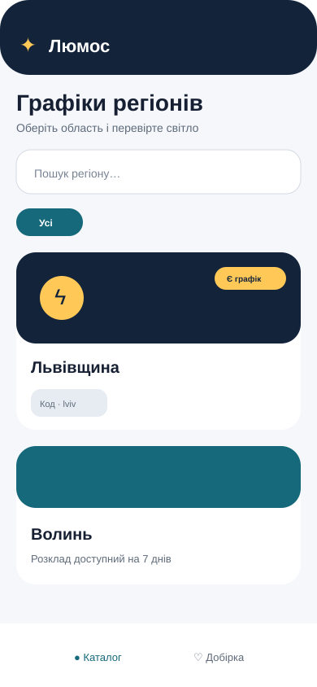
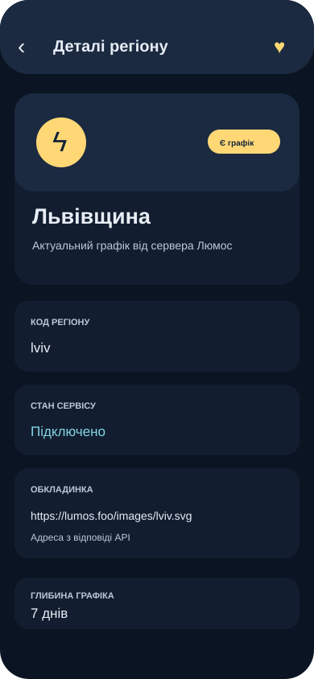

# Макети Люмос · лабораторна 13

Готові SVG-макети є векторним аналогом двох кадрів Figma:

- `catalog.svg` — каталог у світлій схемі;
- `details.svg` — деталі регіону в темній схемі.

Система побудована на трьох акцентах: нічний синій `#13233A`, сонячний жовтий `#FFC857` та електричний бірюзовий `#16697A`. Базовий крок відступів — 8 px, радіуси карток — 18–24 px. Реалізація бере кольори, типографіку й форми з `MaterialTheme`; системний dynamic color навмисно не підключений, тому фірмові кольори не перекриваються шпалерами.

